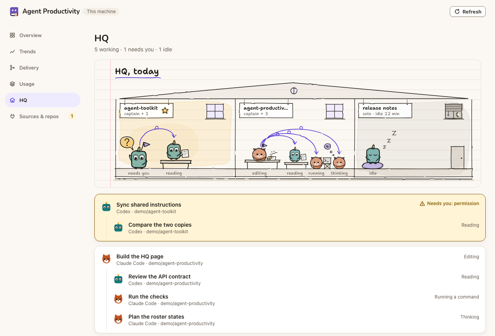

# Agent Productivity HQ

See what your coding agents are doing now in HQ, then review what merged on GitHub and how many tokens Codex and Claude Code recorded this week.


_Overview with synthetic data._

## Choose how to run it

The private release candidate ships with checksums and [local installation instructions](docs/delivery/setup.md#run-the-private-release-candidate-with-npx). New users can also [run from source](#run-from-source).

| Launch method | Prerequisite and first-time setup                                                                                                            | Open the dashboard                                                                                          |
| ------------- | -------------------------------------------------------------------------------------------------------------------------------------------- | ----------------------------------------------------------------------------------------------------------- |
| Terminal      | A compatible Node runtime with npm and the [private CLI archive](docs/delivery/setup.md#run-the-private-release-candidate-with-npx)          | `npx --package="/absolute/path/to/kelvicthrust-agent-productivity-hq-0.3.0-rc.1.tgz" agent-productivity-hq` |
| Paseo         | An Apple Silicon Paseo host with Tailscale and the [Agent HQ plugin installed](docs/delivery/setup.md#install-the-private-release-candidate) | Click **Agent HQ** in the Paseo sidebar.                                                                    |
| Agent skill   | The same Node runtime and the [skill installed](docs/delivery/setup.md#install-the-agent-skill) for Claude Code or Codex                     | Enter `/agent-productivity-hq` in Claude Code or `$agent-productivity-hq` in Codex.                         |

After the public release, install the CLI with `npx --yes @kelvicthrust/agent-productivity-hq` or the skill with `npx skills add kelvicthrust/agent-productivity-hq`. Paseo users can install the published npm plugin using the [Paseo instructions](docs/delivery/setup.md#open-agent-hq-from-paseo-desktop).

**Node compatibility.** The packaged dashboard runs on Node 22.16.0 or later in the 22.x line and on stable Node 24.0.0 or newer. Node 23.x lacks the SQLite transaction API the dashboard uses. Paseo checks the host for a compatible Node installation and offers a private runtime download if needed. Building from source requires Node 26 or newer.

## HQ: your agents at work

Open **HQ** in the dashboard to see which sessions are working and which may need your input. Each illustrated room groups a session with its helpers. The roster lists waiting sessions first, so you can find a permission request or question and respond in the original session.



_HQ with synthetic sessions._ [Read the HQ guide](docs/product/hq.md) for status meanings, live sources, and optional Claude Code wait reporting.

## Run from source

### Requirements

- Node 26 or newer (manifest range `>=26.0.0`) and pnpm 11.25.0.
- Registry access for dependency installation from a fresh checkout.
- macOS Keychain if you use the GitHub App sign-in. The GitHub CLI is the other sign-in option.

### Install and run

From the repository root, run:

```sh
pnpm install --frozen-lockfile
pnpm build
pnpm start
```

Open <http://127.0.0.1:4317> when the server prints
`Agent Productivity HQ is running at http://127.0.0.1:4317`. The server serves the production build from
`dist/client` on loopback. Stop it with Ctrl+C. To try the dashboard with invented data, use the
[synthetic preview](#the-synthetic-preview).

The [local setup guide](docs/delivery/setup.md) covers
[configuration](docs/delivery/setup.md#environment-variables),
[startup recovery](docs/delivery/setup.md#when-something-is-wrong), and
[upgrades and rollback](docs/delivery/setup.md#upgrade-and-rollback). If you used Kelvin Agent Crew,
follow the [cutover guide](docs/delivery/setup.md#move-from-kelvin-agent-crew) to keep the old data
and configure a fresh installation.

### First launch (Setup)

1. Check which local sources the dashboard found on the machine where it runs.
2. Continue through the optional account connections and repositories. To see merged PRs, connect
   GitHub and add at least one repository. The dashboard reuses a signed-in `gh` when available. Otherwise,
   Sources & repos guides you through a [GitHub App connection](docs/tech/data-and-sources.md#github-delivery).
3. Select **Finish setup**. Overview opens and the first import starts. Use **Sources & repos**
   to see what was collected or change your choices later.

Setup works with zero sources, accounts or repositories and requires neither an API key nor an
environment file. The discovery step checks locations before the first import reads transcript history.

## Using the dashboard

1. Start at **Overview**. It opens on **This week** with your authored PRs selected. Use the period
   and repository filters to change the review. Select a chart bucket or switch to **Table** to
   inspect its records.
2. Open a PR in **Delivery** to see linked sessions and the basis for each link. A session that
   names a PR or commit supplies evidence. A same-repo session active in the 48 hours before the
   merge may be a suggestion. Your confirmations and corrections persist. Use **Undo** on the
   notification to reverse a change.
3. Use **Usage** to inspect tokens by provider, repository, and session, including recorded child
   agents. Use **Trends** for longer periods and model breakdowns.
4. Open **Sources & repos** to check coverage or search the repositories your GitHub sign-in can
   access. Choose **Track** on each repo to include. For subscription data, use the optional
   [ChatGPT account report](docs/tech/data-and-sources.md#chatgpt-account-report) or choose
   [Show Claude plan limits](docs/tech/data-and-sources.md#claude-account-report) to check using
   your existing Claude Code sign-in. After the first successful check, **Refresh** and
   **Refresh all** also update those limits.

### What the numbers cover

- **Merged PRs** count once per merge. A linked session’s tokens belong to that session.
- **Recorded local tokens** come from readable Codex and Claude Code history on the installation
  host. The dashboard distinguishes unavailable history from a measured zero and retains imported metrics
  for up to 366 days. It stores metrics and identifying metadata without storing conversation text.
- **Account-reported usage** shows the share of each provider’s weekly plan limit used and when
  it resets. Claude’s five-hour window appears below its weekly reading. Repository and date
  filters leave these provider windows unchanged.
- **Paseo**, when available, adds recorded agent names and relationships. It contributes no tokens.
  See the [source contracts and limitations](docs/tech/data-and-sources.md#paseo-enrichment).

### The synthetic preview

After installing dependencies, run `pnpm preview:seed` and open <http://127.0.0.1:4317>.
It builds if needed, serves invented data from `.preview-data/`, and uses scripted sources and
accounts. Use a different `AGENT_PRODUCTIVITY_PORT` if the dashboard is already listening. Keep the
preview’s data directory separate from your normal installation.

- `pnpm preview:seed --scenario empty` opens first-run Setup with synthetic sources.
- `pnpm preview:seed --scenario refresh-failed --retry fails-once` exercises retry with retained data.
- `pnpm preview:seed --scale year` loads a full year of fixture data.

The [preview script](scripts/preview-seed.ts) lists the other scenarios and flags. To seed just a
fixture database, use `pnpm seed --db <file>`.

## Checks

| Command                            | What it checks                                                                                                                    |
| ---------------------------------- | --------------------------------------------------------------------------------------------------------------------------------- |
| `pnpm verify`                      | Dependency pins, types, lint, formatting, token parity, Vitest and production build.                                              |
| `pnpm test:contract`               | API response and OpenAPI contracts.                                                                                               |
| `pnpm test:e2e`                    | Browser behavior on a production build. Use `--grep @a11y` for keyboard and axe checks or `--grep @responsive` for layout checks. |
| `pnpm bench`                       | Server performance budgets on synthetic data. Run separately from the test suite.                                                 |
| `pnpm bench:browser`               | Chart redraw and import responsiveness. Read the report verdict for the budget result.                                            |
| `pnpm audit --prod`                | Published production dependency advisories. Requires registry access.                                                             |
| `pnpm reconcile`                   | Compare local Codex and Claude Code counts with ccusage. See the [reconciliation guide](docs/implementation/reconcile.md).        |
| `pnpm experiments:selftest`        | Run the provider experiment scripts against synthetic fixtures.                                                                   |
| `pnpm check:pins`                  | Check pinned dependency compatibility.                                                                                            |
| `pnpm format`                      | Apply Prettier formatting.                                                                                                        |
| `pnpm test:tokens`, `pnpm test:e7` | Check token generation and the Astryx/Tailwind bridge.                                                                            |
| `node scripts/capture-fidelity.ts` | Compare rendered screens with the design prototype.                                                                               |

The [setup guide](docs/delivery/setup.md#routine-checks) lists the individual routine checks. See
[package.json](package.json) for the full script list and token parity command.

## Gotchas

- `pnpm dev` serves the Vite client shell. Build and start the dashboard for the complete app with its API.
  Run `pnpm build` again after changing the client.
- If the pinned Chromium shell is missing, run `pnpm exec playwright install --only-shell chromium`.
  See the [browser configuration](playwright.config.ts) and the
  [browser cache setting](docs/delivery/setup.md#environment-variables).
- Use the project’s existing Astryx configuration. Running `astryx init` would overwrite its
  maintained agent guidance.
- Provider sign-in, real-history attribution, and the synthetic preview have different coverage.
  The [experiment runbook](docs/implementation/experiments/README.md) and
  [historical delivery handoff](docs/archive/delivery/handoff.md) record what was exercised and with which revision.

## Design tokens

[design-system/DESIGN.md](design-system/DESIGN.md) defines the tokens. Use the generation and parity
scripts in [package.json](package.json) to update and check `src/client/theme/generated/`.

## Project context

- [AGENTS.md](AGENTS.md) maps the repository and change checks.
- [Product brief](PRODUCT.md) and [design brief](DESIGN.md) describe the intended experience.
- [Architecture](TECH.md), [data and sources](docs/tech/data-and-sources.md), and the
  [local API](docs/tech/local-api.md) define the technical contracts.
- The [project archive](docs/archive/README.md) summarizes implementation, design and delivery history.
- The [implementation evidence map](docs/archive/implementation/candidate-handoff.md) points to milestone
  checks and historical evidence gaps.

## License

Agent Productivity HQ is available under the [MIT License](LICENSE). Published packages include their third-party notices.
