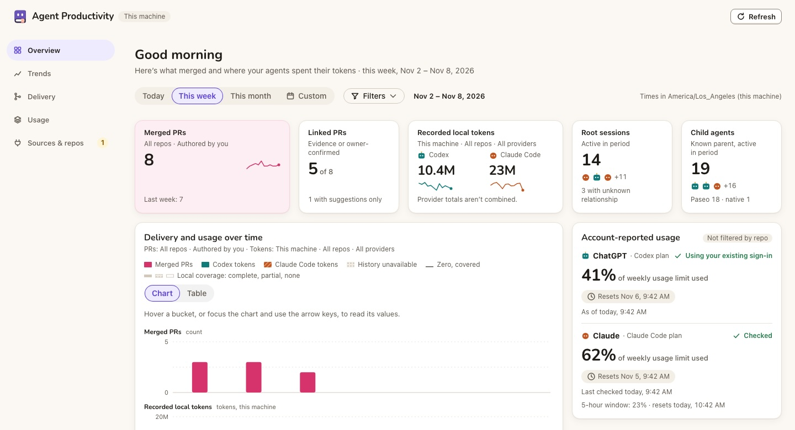

# Agent Productivity HQ

[](https://www.npmjs.com/package/@kelvicthrust/paseo-agent-productivity-hq)

Agent Productivity HQ is a private dashboard for your AI coding work. See which agents are busy, find the conversations that need your attention, and review what made it into your GitHub projects. Track how much Codex and Claude Code you use over time and see which sessions were involved in a change when HQ can make the connection.



_Overview with synthetic data._

## What it supports

- **Codex and Claude Code** show current activity and recorded usage from the Mac running HQ. See which models and sessions used the most tokens, the units AI tools use to measure text they process or generate.
- **GitHub** shows merged changes from the projects you choose to track. Open a change to see the agent sessions HQ can link to it and the evidence behind each link.
- **ChatGPT and Claude subscriptions** can show how much of your plan limit you’ve used and when it resets, where your provider reports it.
- **Paseo** opens the illustrated HQ, setup, and reports inside Paseo. It supplies live agent
  activity, relationships between agents, and weekly plan limits when available.

HQ keeps its collected usage data on the Mac that runs your agents. You choose which accounts and
projects to connect. Anyone with permission to manage Paseo on that Mac can also see its HQ data
and manage its connections.

## Getting started

Use the Apple Silicon Mac that runs your agents. You can ask an agent to install and open HQ, run one command in Terminal, or open it from Paseo. [Quick start](#quick-start)

### First launch (Setup)

1. Open HQ and review the activity sources it found on the Mac that runs your agents.
2. To see merged changes, connect GitHub and choose the projects you want to track. You can add this connection and optional subscription reports later.
3. Choose **Finish setup**. Paseo opens the illustrated HQ and the standalone dashboard opens
   **Overview**. Use **Sources & repos** whenever you want to change what HQ tracks.

You can finish Setup and explore local activity before connecting an account.

## Quick start

### Ask an agent to install HQ

Paste this prompt into Codex, Claude Code, or another agent that can run commands on your Mac. The guide tells it how to check the Mac, open HQ, and give you the browser address or the Terminal command if it needs you to run it. [Agent setup guide](docs/delivery/agent-setup.md)

```text
Install and open Agent Productivity HQ on the Mac that holds my agent activity. Follow https://raw.githubusercontent.com/kelvicthrust/agent-productivity-hq/main/docs/delivery/agent-setup.md and give me the dashboard URL.
```

### Open it yourself

| Launch method | Before you start                                                                                                                                                             | Open the dashboard                                              |
| ------------- | ---------------------------------------------------------------------------------------------------------------------------------------------------------------------------- | --------------------------------------------------------------- |
| Terminal      | Use an Apple Silicon Mac with [Node.js and npm](#node-compatibility). [Use a downloaded archive](docs/delivery/setup.md#run-a-release-archive-with-npx)                      | `npx --yes @kelvicthrust/agent-productivity-hq`                 |
| Paseo         | Use Paseo 0.16.1 or later and install [Agent HQ from the Paseo plugin directory](https://paseo.sh/plugins/kelvicthrust/agent-productivity) on the Mac that runs your agents. | Select that Mac in Paseo and click **Agent HQ** in the sidebar. |

The Terminal command opens HQ in your browser. If needed, copy the address it prints into your browser. [Downloadable releases](https://github.com/kelvicthrust/agent-productivity-hq/releases/latest)

In Paseo, a fresh installation opens Setup. After setup, **Agent HQ** opens the illustrated HQ.
Workspaces with pending input can show **Needs your answer** in the Paseo sidebar.

In Paseo, choose **Open full dashboard** to open HQ in your browser using the host owner's
Tailscale account. Use **Sources & repos → Open owner settings** and the Mac owner's unlock code
to reset HQ or change Claude Code settings.
[Paseo setup guide](docs/delivery/setup.md#open-agent-hq-from-paseo-desktop)

## HQ: your agents at work

Open **HQ** in the dashboard to see what your agents are doing now. Each illustrated room represents a conversation or task. When HQ can identify the main agent and its helpers, they share a room so you can see who is doing what. The **Sessions** list below the illustration puts waiting sessions first.


_HQ with sample sessions._

- **Editing**, **Reading**, and **Running a command** show what an agent is doing. **Idle for…** shows how long it has been inactive.
- **Needs you** means the source reported a wait. HQ can show the reason, such as a question or permission request, when the source provides it. Return to the original conversation to respond.
- **May be waiting for you** means recent activity suggests a pause. Check the original conversation to see whether the agent needs anything.

HQ refreshes about every two seconds while the view is open. **A quiet one** means the available sources have no running agents to show. For more precise waiting statuses from Claude Code sessions outside Paseo, you can enable optional reporting in **Sources & repos**. [HQ guide](docs/product/hq.md)

## Using the dashboard

- **Overview** shows what merged this week and how much you used your agents. Change the dates or projects, then open a chart point or switch to **Table** to see the details.
- **Delivery** lists merged GitHub pull requests. Open one to see the conversations linked to it and review any suggested matches.
- **Usage** shows how many tokens each tool, project, and conversation used. **Trends** shows changes over time and which models used those tokens.
- **Sources & repos** shows which sources are available and lets you manage accounts, projects, and collection settings.

In the browser, open **About Agent Productivity HQ** from the app bar to check your version or find release notes and troubleshooting.

### Generate a work update

In **Overview**, choose your date range and select the **Work Review** card to read the full update. Use **Manage review** to open the same period in **Delivery → Work Review**. On first use, choose **Manage ChatGPT connection** to set up the separate sign-in. In Paseo, the **Work Review** card is also on **HQ**. Both Paseo dashboards show saved reviews in **Delivery → Work Review**. [Work Review setup and owner access](docs/delivery/setup.md#connect-work-review)

Choose **Generate update** and confirm to send selected session excerpts and PR metadata to OpenAI. Check the evidence on a bullet, or use **Copy update** for a team update. Opening saved reviews uses no model allowance. If new evidence arrives after a period closes, **Create revision** saves a new version.

To refresh the current week automatically, turn on **Keep this week up to date** in **Delivery → Work Review**. This stays on across weeks until you turn it off or disconnect Work Review. While HQ runs, it can send changed evidence to OpenAI using your ChatGPT allowance at most once every six hours. This covers **My PRs**, all repositories, and both agent providers.

## Data and compatibility

### What the numbers cover

- **Merged PRs** count once per merge. A linked session’s tokens belong to that session.
- **Recorded local tokens** come from readable Codex and Claude Code history on the installation
  host. The dashboard distinguishes unavailable history from a measured zero and retains imported metrics
  for up to 366 days. It stores metrics and identifying metadata without storing conversation text.
- **Account-reported usage** shows the share of each provider’s weekly plan limit used and when
  it resets. Claude’s five-hour window appears below its weekly reading. Repository and date
  filters leave these provider windows unchanged.
- **Paseo**, when available, adds recorded agent names and relationships. It contributes no tokens.
  See the [source contracts and limitations](docs/tech/data-and-sources.md#paseo-enrichment).

**Session links.** A session that names a pull request or commit supplies evidence. A session active in the same repository in the 48 hours before a merge may appear as a suggestion. You can confirm or correct the match and use **Undo** to reverse it.

**Optional account reports.** In Paseo, HQ uses the selected Mac’s Paseo quota reports when available.
If a weekly report is unavailable, HQ can offer **Check Codex directly** or **Check Claude Code directly**.
In the standalone dashboard, connect ChatGPT for Codex quota or select **Show Claude plan limits**
to use your existing Claude Code sign-in. After the first successful Claude check, **Refresh** and
**Refresh all** also update those limits. [ChatGPT reports](docs/tech/data-and-sources.md#chatgpt-account-report) · [Claude reports](docs/tech/data-and-sources.md#claude-account-report)

### Node compatibility

The packaged dashboard runs on Apple Silicon with Node.js 22.16.0 or later in the 22.x line, or stable Node.js 24.0.0 or newer. Paseo checks the host for a compatible version and offers a private runtime download if needed.

## Run from source

### Requirements

- **Node.js 26 or newer** (manifest range `>=26.0.0`) and **pnpm 11.25.0** for this checkout.
- Registry access for dependency installation from a fresh checkout.
- macOS Keychain if you use the GitHub App sign-in. The GitHub CLI is the other sign-in option.

### Install and run

From the repository root, run the following commands.

```sh
pnpm install --frozen-lockfile
pnpm build
pnpm start
```

Open <http://127.0.0.1:4317> when the server prints
`Agent Productivity HQ is running at http://127.0.0.1:4317`. The server serves the production build from
`dist/client` on loopback. Stop it with Ctrl+C. To try the dashboard with invented data, use the
[synthetic preview](#the-synthetic-preview).

The [local setup guide](docs/delivery/setup.md) covers
[configuration](docs/delivery/setup.md#environment-variables),
[startup recovery](docs/delivery/setup.md#when-something-is-wrong), and
[upgrades and rollback](docs/delivery/setup.md#upgrade-and-rollback). If you used Kelvin Agent Crew,
follow the [cutover guide](docs/delivery/setup.md#move-from-kelvin-agent-crew) to keep the old data
and configure a fresh installation.

### The synthetic preview

After installing dependencies, run `pnpm preview:seed` and open <http://127.0.0.1:4317>.
It builds if needed, serves invented data from `.preview-data/`, and uses scripted sources and
accounts. Use a different `AGENT_PRODUCTIVITY_PORT` if the dashboard is already listening. Keep the
preview’s data directory separate from your normal installation.

- `pnpm preview:seed --scenario empty` opens first-run Setup with synthetic sources.
- `pnpm preview:seed --scenario refresh-failed --retry fails-once` exercises retry with retained data.
- `pnpm preview:seed --scale year` loads a full year of fixture data.

The [preview script](scripts/preview-seed.ts) lists the other scenarios and flags. To seed just a
fixture database, use `pnpm seed --db <file>`.

## Checks

| Command                            | What it checks                                                                                                                    |
| ---------------------------------- | --------------------------------------------------------------------------------------------------------------------------------- |
| `pnpm verify`                      | Dependency pins, types, lint, formatting, token parity, Vitest and production build.                                              |
| `pnpm test:contract`               | API response and OpenAPI contracts.                                                                                               |
| `pnpm test:e2e`                    | Browser behavior on a production build. Use `--grep @a11y` for keyboard and axe checks or `--grep @responsive` for layout checks. |
| `pnpm bench`                       | Server performance budgets on synthetic data. Run separately from the test suite.                                                 |
| `pnpm bench:browser`               | Chart redraw and import responsiveness. Read the report verdict for the budget result.                                            |
| `pnpm audit --prod`                | Published production dependency advisories. Requires registry access.                                                             |
| `pnpm reconcile`                   | Compare local Codex and Claude Code counts with ccusage. See the [reconciliation guide](docs/implementation/reconcile.md).        |
| `pnpm experiments:selftest`        | Run the provider experiment scripts against synthetic fixtures.                                                                   |
| `pnpm check:pins`                  | Check pinned dependency compatibility.                                                                                            |
| `pnpm format`                      | Apply Prettier formatting.                                                                                                        |
| `pnpm test:tokens`, `pnpm test:e7` | Check token generation and the Astryx/Tailwind bridge.                                                                            |
| `node scripts/capture-fidelity.ts` | Compare rendered screens with the design prototype.                                                                               |

The [setup guide](docs/delivery/setup.md#routine-checks) lists the individual routine checks. See
[package.json](package.json) for the full script list and token parity command.

## Gotchas

- `pnpm dev` serves the Vite client shell. Build and start the dashboard for the complete app with its API.
  Run `pnpm build` again after changing the client.
- If the pinned Chromium shell is missing, run `pnpm exec playwright install --only-shell chromium`.
  See the [browser configuration](playwright.config.ts) and the
  [browser cache setting](docs/delivery/setup.md#environment-variables).
- Use the project’s existing Astryx configuration. Running `astryx init` would overwrite its
  maintained agent guidance.
- Provider sign-in, real-history attribution, and the synthetic preview have different coverage.
  The [experiment runbook](docs/implementation/experiments/README.md) and
  [historical delivery handoff](docs/archive/delivery/handoff.md) record what was exercised and with which revision.

## Design tokens

[design-system/DESIGN.md](design-system/DESIGN.md) defines the tokens. Use the generation and parity
scripts in [package.json](package.json) to update and check `src/client/theme/generated/`.

## Project context

- [AGENTS.md](AGENTS.md) maps the repository and change checks.
- [Product brief](PRODUCT.md) and [design brief](DESIGN.md) describe the intended experience.
- [Architecture](TECH.md), [data and sources](docs/tech/data-and-sources.md), and the
  [local API](docs/tech/local-api.md) define the technical contracts.
- The [project archive](docs/archive/README.md) summarizes implementation, design and delivery history.
- The [implementation evidence map](docs/archive/implementation/candidate-handoff.md) points to milestone
  checks and historical evidence gaps.

## License

Agent Productivity HQ is available under the [MIT License](LICENSE). Published packages include their third-party notices.
